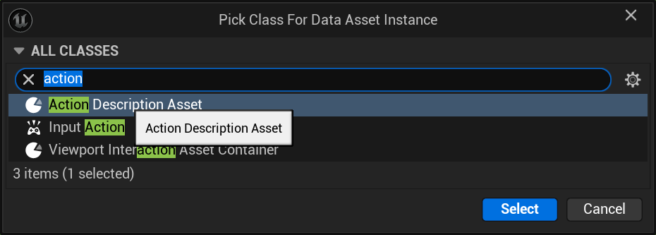
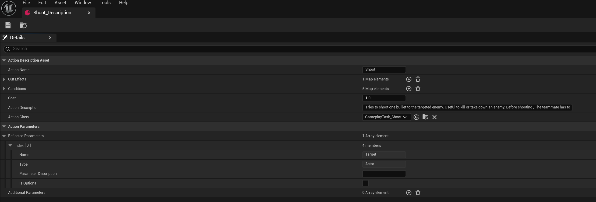
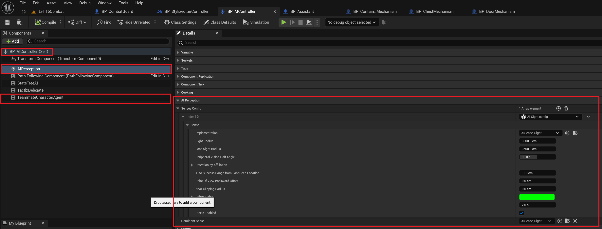
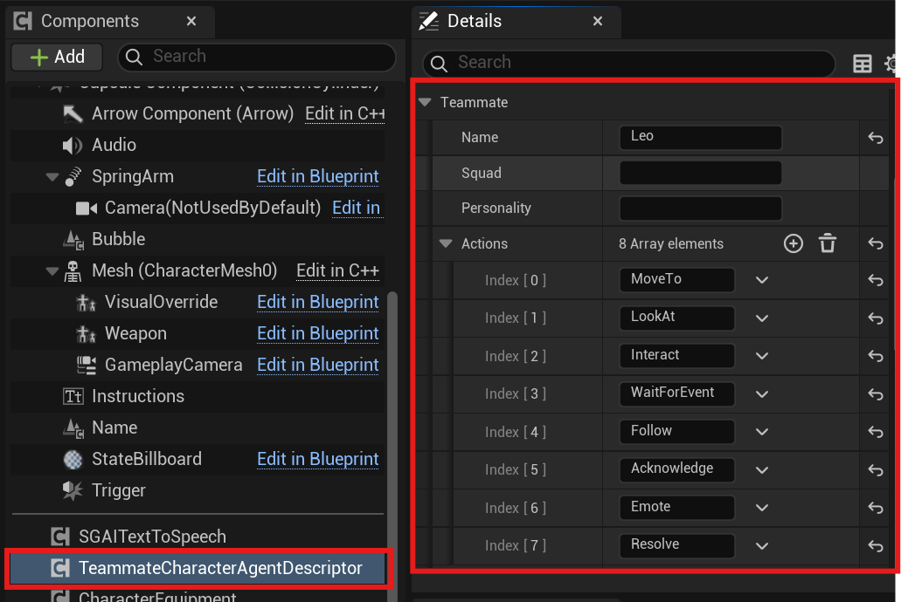
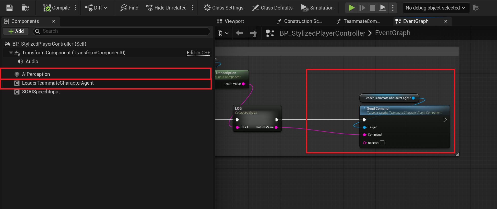
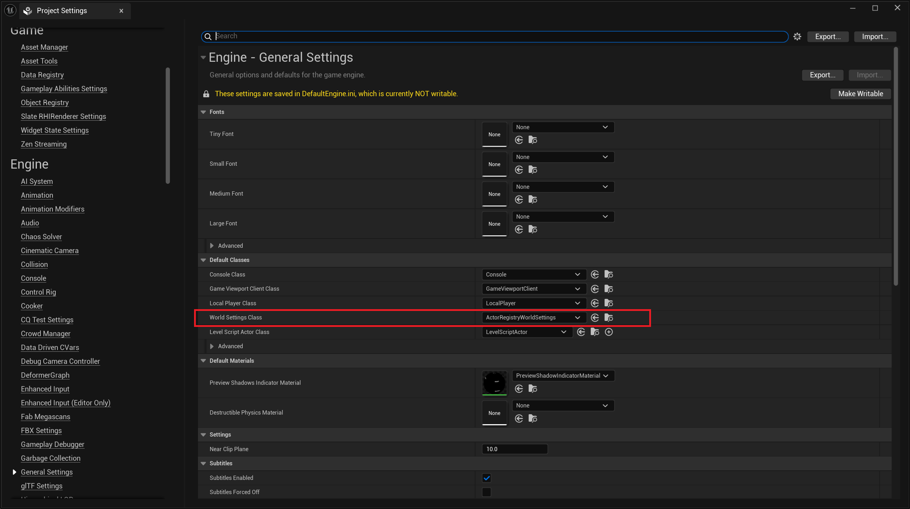
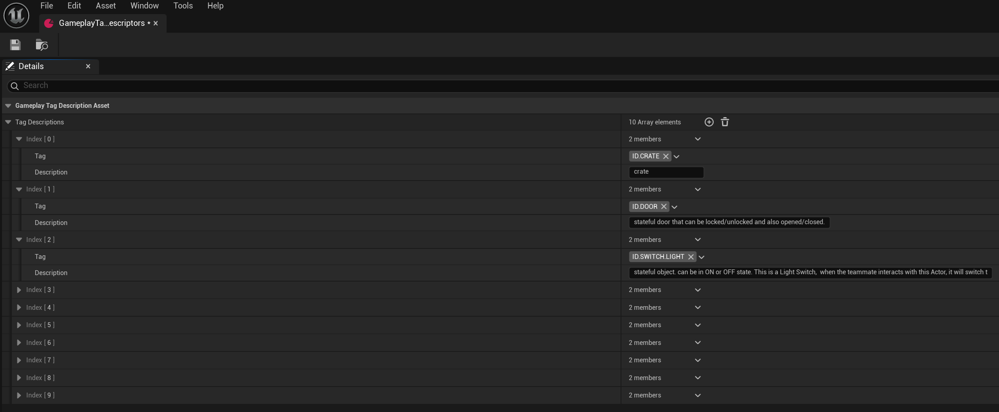
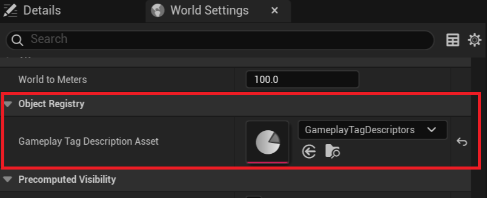
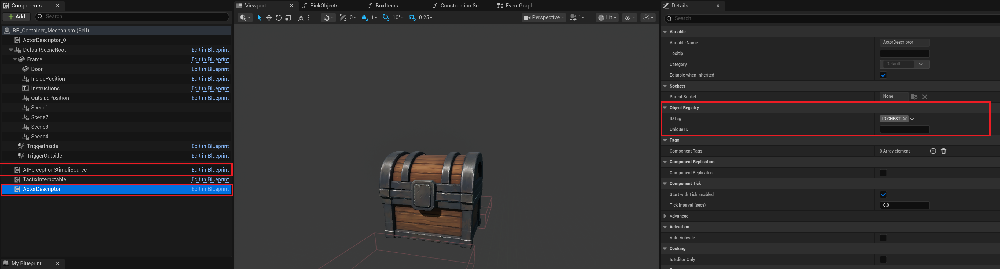
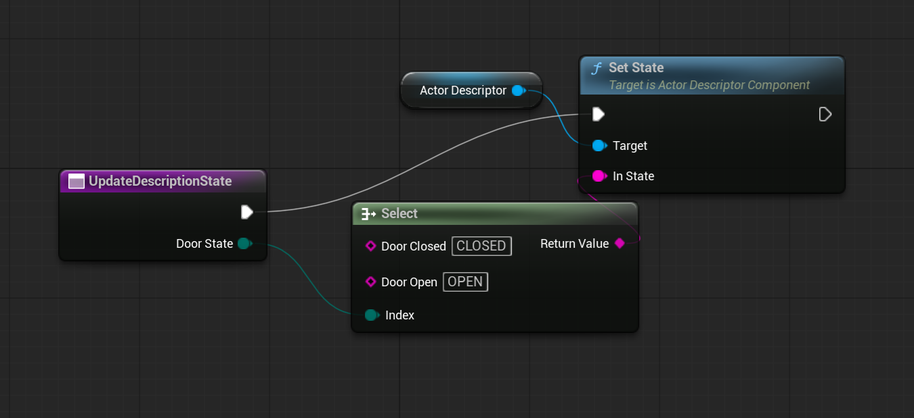

# MindSand Behavioral Engine

## Getting Started

This tutorial walks through setting up a MindSand AI teammate in Unreal Engine 5.

## Part 1: Set Up MindSand and Its Dependencies

1. Add the MindSand and SGAI plugins to your Unreal project’s `Plugins` folder.
2. Build your project.
3. Follow the SGAI instructions to configure its pipeline and apply the required modifications to `DefaultEngine.ini`. These settings allow communication with the language model of your choice.

To connect to a cloud-hosted model, add the following settings to `DefaultEngine.ini`. Gemini is shown as an example:

```ini
[HttpLLMProvider]
api_scheme=http
api_host=[MODEL IP ADDRESS]
api_path=/
model=[gemini-2.0-flash]
streaming=false
temperature=0.4
topk=40
topp=0.5
```

## Part 2: Create Actions

### Step 1: Implement action tasks

To create an action, derive a C++ class from `UGameplayTask_Action` or create a Blueprint based on `UGameplayTask_Action_BP`.

Implement `Activate()` and, for tickable tasks, `TickTask()` in C++. In Blueprint, implement `ActivateBP` and, for tickable tasks, `TickTaskBP`.

Override `ProcessParameters(const FString&)` in C++ or implement `ProcessParametersBP` in Blueprint when the action has custom parameters or requires custom parameter parsing.

Call `EndAction(bool)` in C++ or `EndActionBP(bool)` in Blueprint to signal that the action has finished.

Create the tasks your character needs. Common examples include moving, interacting, and attacking. The plugin also includes C++ tasks for resolving objects based on relative position; use them as examples.

### Step 2: Create action description assets

Action Description Assets tell MindSand each action’s name, required parameters, and implementing Gameplay Task class. The `TeammateActions` folder should already contain a `MoveToObject` Action Description. Create one for `Interact` as well.

#### Create the asset



1. In the Content Browser, navigate to a folder of your choice.
2. Right-click an empty area and choose **Miscellaneous > Data Asset**.
3. In the **Pick Class For Data Asset Instance** dialog, select **Action Description Asset**, then click **Select**.
4. Name the new asset.

#### Fill in the asset details



Double-click the new asset to open it, then fill in these fields:

- **Action Name:** The action name used by the language model.
- **Action Description:** What the action does and its result.
- **Conditions:** Conditions required to use the action.
- **Effects:** Boolean effects to apply after the action succeeds.
- **Action Class:** The `UGameplayTask_Action` implementation.
- **Action Reflected Parameters:** Automatically populated from the public properties (`UPROPERTY` fields) of the selected action class. You can add or modify the default values.

To add a parameter, click **+** and expand the new element. Set its **Name**, **Parameter Description**, and **Type**. The description is automatically populated from the property’s `ToolTip` metadata when available. Supported types include Actor, Float, Int, String, Bool, and arrays of these types.

## Part 3: Set Up the Teammate

### Step 1: Add the required components

Add the following components to the teammate’s pawn and controller, as indicated:



1. **AIPerception** (controller)
   - Allows the AI to perceive objects in the world.
   - Select the component and open the Details panel.
   - Under **AI Perception > Senses Config**, click **+** to add an element.
   - Set the sense type to **AISense Sight Config** (`AISense_Sight`), then configure:

     | Setting | Value |
     | --- | --- |
     | Implementation | `AISense_Sight` |
     | Sight Radius | 3000.0 cm |
     | Lose Sight Radius | 3500.0 cm |
     | Peripheral Vision Half Angle | 90.0 degrees |
     | Starts Enabled | `true` |

2. **TeammateCharacterAgentComponent** (controller)
   - The MindSand agent component that connects the controller to the behavioral engine.

3. **TeammateCharacterAgentDescriptor** (pawn)
   - Defines the teammate’s name, squad, personality, and available actions.

### Step 2: Configure the teammate descriptor

Select `TeammateCharacterAgentDescriptor` in the pawn’s Components panel. In the Details panel, configure the teammate’s **Actions**, **Name**, **Squad**, and **Personality** under **MindSand > Teammate**. Add the action names the teammate is allowed to use.



## Part 4: Set Up the Leader (Player) Controller

Open `BP_ThirdPersonController_TUT` (parent class: **Third Person Player Controller**). This player controller acts as the leader that issues commands to teammates.

### Step 1: Add components

1. **LeaderTeammateCharacterAgentComponent**
   - Lets the player issue commands to teammates.



2. **AIPerception**
   - Configure it as in Part 3:

     | Setting | Value |
     | --- | --- |
     | Senses Config | 1 element |
     | Sense type | AISense Sight Config |
     | Sight Radius | 3000.0 cm |

## Part 5: Set Up Object Descriptions

For MindSand to identify and perceive an object, the object needs:

- An `ActorDescriptorComponent` so the AI can read its description.
- A **Perception Stimuli Source** so the AI can perceive it.

Create a centralized `GameplayTagDescriptionAsset` containing hierarchical Gameplay Tags and descriptions for your objects. You will also need to set the world’s World Settings class to `ActorRegistryWorldSettings` or a custom class that inherits from it.

### Step 1: Configure World Settings and create the tag description asset

1. In **Project Settings > Engine > General Settings > World Settings Class**, select `ActorRegistryWorldSettings` or a custom World Settings class that inherits from it.

   

2. Use Unreal Engine’s Gameplay Tag Manager or add entries to `DefaultGameplayTags.ini` to create a tag for each object. Start each tag with the `ID` root and organize tags into categories, for example, `ID.CRATE.BLUE` and `ID.CRATE.RED`.
3. Create the `GameplayTagDescriptionAsset`:
   1. In the Content Browser, navigate to a folder of your choice.
   2. Right-click an empty area and choose **Miscellaneous > Data Asset**.
   3. In the **Pick Class For Data Asset Instance** dialog, select **Gameplay Tag Description Asset**, then click **Select**.
   4. Name and open the new asset.
   5. Add a Gameplay Tag and description pair for each object.

   

4. In the World Settings panel, find **Gameplay Tag Description Asset** and select the asset you created.

   

### Step 2: Configure the Actor Descriptor component

Select `ActorDescriptorComponent` in the Components panel. In Details, under **Actor Registry > ID Tag**, select the Gameplay Tag associated with this object in the `GameplayTagDescriptionAsset`.



This description is what the AI reads when it perceives the object. Make sure it accurately describes the object.

### Step 3: Configure the Perception Stimuli Source

Select **Perception Stimuli Source** in the Components panel. In Details, under **AI Perception**, set:

- **Auto Register as Source:** `true`
- **Register as Source for Senses:** Add one element, `AISense_Sight`.

This makes the object visible to the teammate’s AI Perception sense.

### Step 4: Update the description dynamically

In the actor’s Blueprint, use a function such as `UpdateDescriptionState` to call the `ActorDescriptorComponent`’s **Set State** node and update the object’s runtime state. The example maps a door-state value to a state string:



This keeps the AI’s description of the object accurate after its state changes.

---

