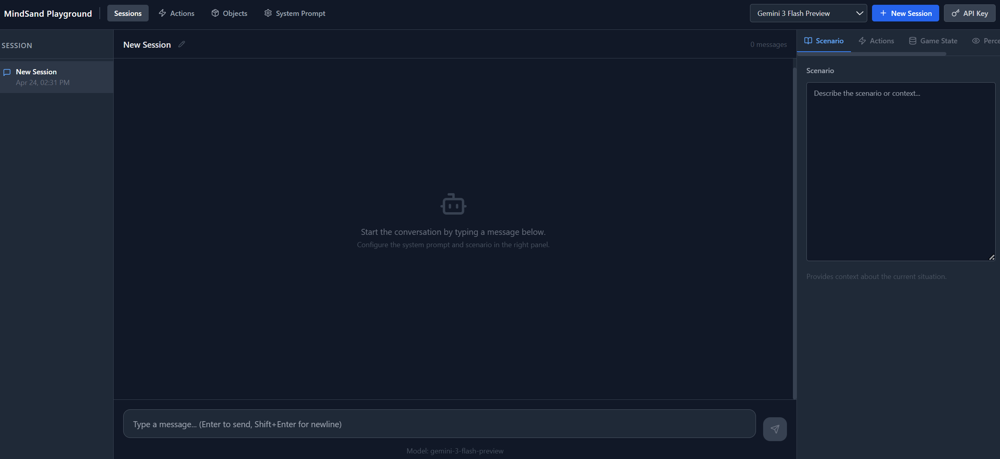

# MindSand-Engine Playground

A web-based LLM interaction platform powered by Google Gemini. Build sessions with custom actions, objects, game state, and perception — then chat with the AI in context.



## Features

- **Sessions** — Single active chat session with full context (game state, perception, actions)
- **Actions** — Define reusable typed actions that the LLM can reference
- **Objects** — Build an object library for use in perception states
- **System Prompt** — Global system prompt applied to all sessions
- **Gemini models** — Gemini 3 Flash Preview and Gemini 3.1 Flash Lite Preview

---

## Prerequisites

- [Node.js](https://nodejs.org/) v18 or later
- A [Google Gemini API key](https://aistudio.google.com/app/apikey) (free tier available)

---

## Setup

### 1. Clone and install

```bash
git clone <your-repo-url>
cd playground
npm install
```

### 2. Configure environment

Copy the example env file and fill in the required values:

```bash
cp .env.example .env
```

Edit `.env`:

```env
DATABASE_URL="file:./prisma/data/dev.db"
```

That's all that's required. The Gemini API key is entered in the UI (not stored in `.env`).

### 3. Set up the database

```bash
npx prisma db push
npm run seed
```

This creates a local SQLite database at `prisma/data/dev.db`.

> **Note:** `prisma generate` runs automatically as part of `npm install` (via the `postinstall` script). MindSand uses Prisma 7 with a WASM-based query engine — no architecture-specific native binaries. Works on x64, ARM64, Windows, macOS, and Linux.

### 4. Run the dev server

```bash
npm run dev
```

Open [http://localhost:3000](http://localhost:3000).

---

## Setting your Gemini API key

1. Get a free API key from [Google AI Studio](https://aistudio.google.com/app/apikey)
2. Click the **API Key** button in the top-right corner of MindSand
3. Paste your key and click **Save**

The key is stored only in your browser's `localStorage` — it is never sent to any server other than Google's Gemini API directly.

---

## Usage

### Sessions
Click **New Session** to start a fresh session. Each new session replaces the previous one. Use the right panel to configure:

- **Scenario** — Describe the current context or situation
- **Actions** — The actions available to the LLM (auto-populated from your Action Library)
- **Game State** — JSON object representing the current world state
- **Perception** — What the AI currently perceives (objects, teammates, etc.)
- **Preview** — See the full assembled prompt that gets sent to Gemini

### Actions
Define reusable actions with typed parameters (Float, String, Actor). Actions are automatically added to new sessions.

### Objects
Build an object library. Objects can be added to a session's perception state via the Perception tab.

### System Prompt
Set a global system prompt that applies to all sessions.

---

## Utility scripts

Seed the database with example actions, objects, and system prompt:

```bash
npm run seed
```

This is idempotent — it only inserts data if the tables are empty. Edit `prisma/systemprompt.txt` before running to pre-load a system prompt.

Clear all data from the database:

```bash
node scripts/clear-db.mjs
```

---

## Tech stack

- [Next.js 14](https://nextjs.org/) — App Router
- [Prisma](https://www.prisma.io/) + SQLite — Local database
- [Google Generative AI SDK](https://www.npmjs.com/package/@google/generative-ai) — Gemini API
- [Zustand](https://zustand-demo.pmnd.rs/) — State management
- [Tailwind CSS](https://tailwindcss.com/) — Styling
